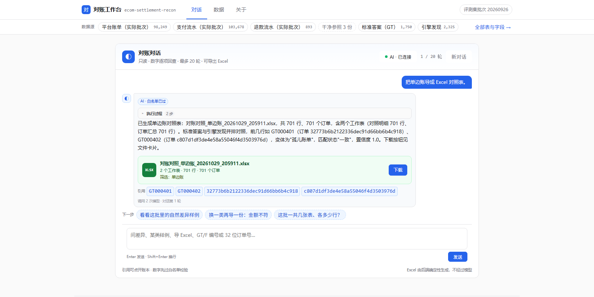
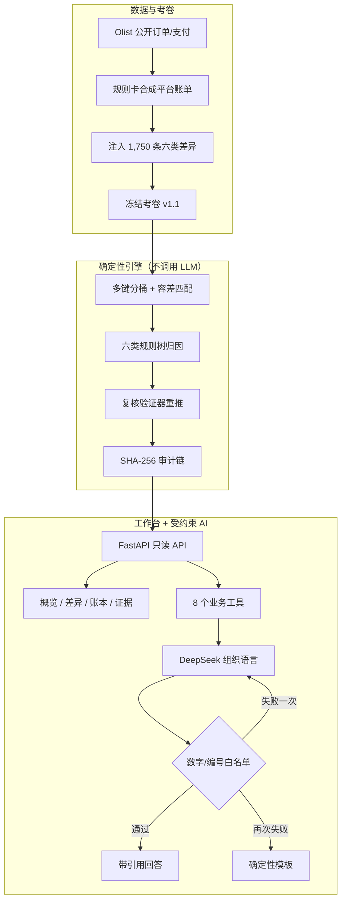
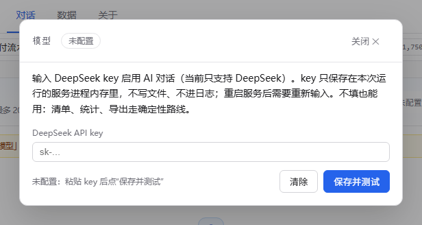

<div align="center">

# 电商结算对账 Agent

<sub>ecom-settlement-recon</sub>

**给电商财务/结算用的对账工具：三本账自动核对，差异能点回原始单据**

本地原型 + 合成数据评测，不是生产系统。本机约 2.5 秒扫 9.9 万单；在我们固定好的一套合成测试集上，1,750 条人工差异全部检出。另有 575 条数据本来就不一致，单独列出；把这 2,325 条发现直接对 1,750 条标准答案时，约 75.3% 的发现能对上。

[](https://www.python.org/)
[](https://fastapi.tiangolo.com/)
[](tests/)
[](docker-compose.yml)
[](LICENSE)

[问题](#问题) · [价值](#产品价值) · [为什么](#为什么这么做) · [效果](#效果) · [评测](#评测结果) · [快速开始](#快速开始) · [边界](#已知边界)



<sub>实际界面：说“把单边账导成 Excel 对照表”，AI 调 `export_diffs` 生成两个工作表（701 行 / 701 个订单），正文只讲事实和可回查引用，下载按钮直接取文件；执行过程答完折叠，点开可看参数与耗时。右上角“AI · 已连接”是模型入口，页面输入的 key 只存内存。</sub>

</div>

> **先说边界**：这是本地原型 + 合成数据评测，不是生产系统，也没有使用任何真实业务账单。对账指“平台账单 × 业务订单 × 支付流水”三方核对。

适合三类人看：

- **电商财务/结算**：想知道能不能少翻表、怎么跑起来；
- **技术负责人**：想看评测口径、引用链和边界；
- **Agent 开发者**：想看“确定性主链路 + 受约束 LLM”的可运行实现。

## 问题

对账是把**平台账单、业务订单、支付流水**三本账对上：金额、退款状态、时间，任何一处不一致都要能定位到具体订单。

这不是假设出来的需求。过往的结算业务里，三方账人工对一遍要 1 天，把规则固化成脚本后能压到 10 分钟量级；但那套脚本留下两个遗憾：

- 脚本跟着具体业务走，换个人、换平台就带不走；
- 结论散在 Excel 和聊天记录里，没法复现，也没人敢签字。

真正难的是三件事，而不是“把两张表 join 一下”：

| 卡点 | 常见做法 | 卡在哪 |
|---|---|---|
| 找错 | 人工翻表 / 各写各的 SQL | 慢、会漏、口径不统一 |
| 解释 | 找到差异后再人工写说明 | 业务看不懂，反复沟通 |
| 复核 | 结论留在脚本和 Excel 里 | 无法回查，换人重做 |

LLM 看起来能一次解决三个问题，但直接让它对着账本回答，会编数字、不可复现——这种结论对账场景没人敢用。

## 产品价值

一句话：把“逐笔翻账 + 手工写说明”变成“看结论 + 抽查引用”。

| 你要做的事 | 现在可以 |
|---|---|
| 找差异 | 直接问“这批有多少单边账、最大的几笔在哪”，拿到清单和解释 |
| 看懂 | 每条差异带归因和原始单据引用，不用自己拼 Excel |
| 复核 | 点引用回查账本；回答里的数字/编号先过白名单，不合规就降级 |
| 带走 | 把差异导成 Excel 对照表（示例 701 行 / 701 个订单） |

能直接问的问题：

> “这批一共多少条差异？” · “GT000401 为什么被判单边账？” · “把单边账导成 Excel 对照表。” · “退款遗漏里金额最大的 10 笔是哪些？”

具体数字和口径见 [评测结果](#评测结果)。

## 为什么这么做

这一节解释取舍；赶时间可以跳过，不影响看效果。

| 决策 | 放弃了什么 | 为什么 |
|---|---|---|
| 确定性引擎跑主链路 | 让 LLM 直接匹配 | 对账结论要可复现、可判分、可审计；BenchRec 同台 99.67% vs 95.20%，规则更准也更便宜 |
| LLM 只组织语言，8 个业务工具（7 个查询只读，`export_diffs` 只写导出文件）+ 1 个收口工具 | 让模型自由查库、写 SQL | 最小权限；答案只能基于事实单（引擎算好、模型只能引用的数据）；模型出错时能降级 |
| 数字/编号白名单，违规重试一次再降级 | 相信模型“自我检查” | 宁可给确定性的模板，也不放行错数字 |
| 对话优先，执行过程可展开 | 表单/报表式界面 | 对账是追问式工作；业务要证据链，开发者要核对调用 |
| key 只放进程内存 | 写配置文件或落盘 | 不写文件、不进日志；代价是重启要重输（本机原型够用） |

### 为什么不让 LLM 直接匹配？

匹配结果要可复现、可判分、可审计，LLM 三样都不稳；成本和延迟也更高。BenchRec 官方 ChatGPT 基线 95.20%，本项目的确定性匹配 99.67%——同台对比说明“规则引擎找错、LLM 解释”不是保守，而是更准。LLM 适合把证据讲清楚，不适合当账本。

### Agent 壳为什么自己写？

没有用 LangChain 之类的框架：需要的只是“工具调用 + 白名单 + 预算”三件事，自研薄循环更容易看清每一轮发生了什么，也便于测试。多轮对话与工具预算也是在这个薄循环上按需加的，没有为框架能力提前埋复杂度。

## 效果

一次本地运行的真实对话，不是设计稿：

- 输入：`把单边账导成 Excel 对照表。`
- 执行：`export_diffs`（约 500ms）→ `submit_chat_answer`；折叠的“执行过程 2 步”可展开看参数与耗时
- 回答：文件卡片（`对照明细` + `订单汇总`，2 个工作表 · 701 行 · 701 个订单）；引用可点开回查；底部显示“调用 2 次模型 · 对话第 1 轮”

等待模型时，前端每 320ms 轮询一次执行记录，逐步出现工具名、参数、结果和耗时；回合结束后执行过程自动折叠，点开可看完整步骤。界面不展示隐藏思维链，只展示实际发生的工具事件。

## 评测结果

### 主考场：Olist 三方对账

| 指标 | 结果 | 口径 |
|---|---|---|
| 冻结考卷 | **1,750 条 / 六类** | 单边账 700、金额不符 500、退款遗漏 200、状态不一致 150、重复结算 100、版本差异 100 |
| 召回 | **100%（1,750/1,750）** | 六类逐类全中 |
| 真误报 | **0** | 575 条自然差异单列，不计入误报 |
| 全量耗时 | **约 2.5 秒 / 9.9 万单** | 纯标准库，无 LLM |
| 引擎发现 | **2,325 条** | 1,750 条人工差异 + 575 条自然差异 |

> **评测口径（先看这段）**
>
> - **同源评测**：冻结考卷由同一套规则卡生成；575 条“自然差异”由建库 SQL 定义；验证器不读引擎结论，但金额期望与造数复用同一规则卡。
> - **1,750 条是人工注入的合成差异**，不是第三方标注。所有 2,325 条发现都拿去对 1,750 条标准答案时，准确率（precision）约 **75.3%**；差掉的 575 条是数据自带的金额不一致，不是引擎编出来的。
> - **BenchRec 表是本地复跑参考成绩**：公开仓库不包含原始数据，复现方式见 [BenchRec 成绩单](docs/reports/p4-benchrec-report.md)。
> - 结论只到“同源考卷 + 公开基准可迁移”，不代表生产泛化；**这不是 SOTA**。

### 跨域：BenchRec 银行现金对账

| 提交 | 精度 | 覆盖率 | 总判对率 |
|---|---:|---:|---:|
| **确定性引擎（本项目）** | **99.67%** | **84.6%** | **90.39%** |
| 官方 ChatGPT 基线 | 95.20% | 64.9% | 65.24% |

数据不随仓库提交（`data/raw/` 已 gitignore），本表为本地复跑参考成绩；来源与许可见 [BenchRec 成绩单](docs/reports/p4-benchrec-report.md)。本地约 1 秒判完 32,048 笔银行流水，纯标准库。判分口径允许“宁缺勿错”：覆盖率 84.6% 表示其余 15.4% 没有被匹配覆盖；系统接受弃权，避免乱配。

当前距竞赛 99.8% 硬门槛差 **0.13pp**；89 个错配已归因，主要来自“唯一金额候选无印证即配”和官方标注噪声。**这不是 SOTA，也不代表生产泛化。**

明细见 [评测总报告](docs/reports/evaluation-report.md)、[确定性引擎成绩单](docs/reports/p2-engine-report.md)、[BenchRec 成绩单](docs/reports/p4-benchrec-report.md)。

## 给工程师：架构与工具

这一节给要读代码的人；不关心实现可以跳过。一句话：引擎负责找错，Agent 只组织语言，账本只读、预算固定。



<details>
<summary>展开：主链路三步与工具预算</summary>

主链路没有 LLM：

1. **引擎**：订单号/参考号/金额/日期多键分桶，金额容差，六类规则树归因；复核验证器不读结论、只凭原始数据重推（金额规则与造数同源）；每步输入输出进 SHA-256 审计链。
2. **Agent 壳**：对模型暴露 `get_overview`、`search_diffs`、`get_diff`、`get_order`、`get_engine_score`、`get_type_stats`、`get_data_inventory`、`export_diffs` 八个业务工具（前 7 个只读查询，`export_diffs` 只写导出文件），另有 `submit_chat_answer` 只用于收口；一轮可并发多个只读调用（上限 4 个），整回合最多 12 次工具调用、6 轮模型往返，20 轮会话上限。
3. **护栏**：提示词限定只能使用事实单；答案里的数字/编号过白名单；违规重试一次，再违规降级为模板；引用编号可点击回查账本。

</details>

## 快速开始

### Windows：双击启动（本机已建好 `.venv`）

仓库根目录有 `启动对账工作台.bat`。如果已经按下面“本机运行”建好 `.venv` 并装好依赖，双击即可启动并打开浏览器；第一次用请先看“本机运行”。

### Docker（推荐）

```bash
git clone https://github.com/TheSKY-3/ecom-settlement-recon.git
cd ecom-settlement-recon
docker compose up --build
```

浏览器打开 **http://127.0.0.1:8770**。首次构建要下载依赖，之后启动很快。

### 本机运行

需要 Python 3.12：

```bash
python3.12 -m venv .venv
source .venv/bin/activate          # Windows PowerShell: .venv\Scripts\Activate.ps1
pip install -r requirements.txt
python -m src.workbench.serve --port 8770
```

AI 出口是可选的。没有 key 也能启动，对话与归因会降级为确定性模板；有 key 时才调用 DeepSeek。两种给 key 的方式：

- **页面输入（推荐）**：打开工作台，点对话页右上角的「模型」，粘贴 key 后点「保存并测试」（保存前先用一次最小调用验证）。key 只存在服务进程内存，不写文件、不进日志；重启服务后需要重新输入，「清除」回落到环境变量。
- **环境变量**：启动前设置 `DEEPSEEK_API_KEY`：

```bash
export DEEPSEEK_API_KEY=your-key   # Windows PowerShell: $env:DEEPSEEK_API_KEY="your-key"
```



不要把 key 写进仓库。测试全部离线，真模型只做单独冒烟：

```bash
python -m pytest -q
# 168 passed
```

> 仓库自带 `data/synthetic/` 合成评测集；`data/raw/` 和 `data/olist.db` 已 gitignore。要查看原始订单证据，先按 `scripts/build_db.py` 从 Kaggle Olist 构建，再挂载给 Docker。
>
> 仓库自带合成样例，**当前版本不支持导入你自己的账单**；工作台只读这份评测集。

<details>
<summary>服务器部署 / 原始订单库（可选）</summary>

镜像是一个自包含的工作台，服务器只需要 Docker。三种带过去的方式：

```bash
# A. 有镜像仓库
docker tag ecom-settlement-recon:latest <registry>/<namespace>/recon:latest
docker push <registry>/<namespace>/recon:latest

# B. 没有仓库：导出再传
docker save -o recon-image.tar ecom-settlement-recon:latest
scp recon-image.tar user@server:/tmp/ && ssh user@server 'docker load -i /tmp/recon-image.tar'

# C. 服务器上有源码
git clone <repo> && cd <repo> && docker compose up -d --build
```

运行：

```bash
docker run -d --name recon-workbench --restart unless-stopped \
  -p 127.0.0.1:8770:8770 \
  -e DEEPSEEK_API_KEY=... \
  ecom-settlement-recon:latest
```

要对外提供服务，建议只绑本机，前面放 Caddy 自动 HTTPS：

```caddy
recon.example.com {
    reverse_proxy 127.0.0.1:8770
}
```

注意：工作台没有登录鉴权，里面是合成数据；不要把真实账单放上去裸奔。原始订单库和引擎产物都按需挂载，镜像默认只带合成评测集。
</details>

## 目录

| 路径 | 内容 |
|---|---|
| `src/engine/` | 装载、匹配、六类规则树、复核验证器、SHA-256 审计链 |
| `src/agent/` | 受约束 Agent：工具、护栏、DeepSeek 客户端、归因与对话服务 |
| `src/workbench/` | FastAPI 只读接口 + 原生 HTML/JS/CSS 工作台，无前端构建链 |
| `src/benchrec/` | BenchRec 跨域匹配器与判分器 |
| `src/synth/` | 规则卡造数、六类差异注入、标准答案生成 |
| `evals/` | 主考场与跨域评测判分 |
| `docs/` | 评测报告、设计文档 |
| `data/synthetic/` | 冻结合成评测集（干净/脏三本账 + 标准答案） |

## 已知边界

- **不是生产系统**：本地原型，没有登录、权限、多租户、任务队列；不要直接把带真实账单的实例暴露到公网。
- **主考场是合成数据**：1,750 条差异是人工注入的冻结考卷；BenchRec 是真实跨域数据，但覆盖率 84.6%，只能证明“同一套匹配思想可迁移”，不能证明生产泛化。
- **575 条自然差异**：建库时盘点发现的真实数据差异，单独分桶；若全部算误报，precision 约 75.3%，这个口径必须说清楚。
- **AI 是可选层**：没有 key 自动降级；模型供应商版本变化可能影响措辞；测试用离线假模型，真模型只做冒烟。
- **不是 SOTA**：BenchRec 99.67% 距 99.8% 门槛还差 0.13pp，89 个错配已归因。

## 数据与许可

- **代码**：MIT，见 [LICENSE](LICENSE)。
- **Olist** 巴西电商公开数据集：CC BY-NC-SA 4.0；仅用于非商业评测与作品展示，派生数据遵循上游许可。MIT 只覆盖本仓库代码，不覆盖 Olist 数据。
- **BenchRec** 银行现金对账基准：CC BY 4.0。
- 仓库内 `data/synthetic/` 由 `src/synth/` 在 Olist 底座上生成；不包含任何真实业务账单。

## 文档

- [评测总报告](docs/reports/evaluation-report.md)
- [确定性引擎成绩单](docs/reports/p2-engine-report.md)
- [BenchRec 跨域成绩单](docs/reports/p4-benchrec-report.md)
- [总体设计](docs/design/2026-09-26-recon-agent-design.md)
- [确定性引擎设计](docs/design/2026-09-26-p2-engine-design.md)
- [受约束 Agent 设计](docs/design/2026-09-26-p3-agent-design.md)
- [BenchRec 设计](docs/design/2026-09-26-p4-benchrec-design.md)
- [工作台设计](docs/design/2026-09-26-workbench-design.md)

---

<sub>最后更新：2026-10-29 · 界面使用真实本地服务截图 · 代码 MIT · 评测数字以仓库内报告为准</sub>
